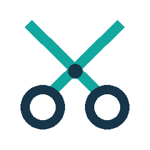

# Sport Clips for Home Assistant

Account-free estimated waits and store status for selected Sport Clips salons.
Independent and unofficial; not affiliated with or endorsed by Sport Clips.

## Install

Requires **Home Assistant Core 2026.10.0 or later**. Automated tests use Core
2026.10.0 and 2026.11.0 with Python 3.14.7; installation and setup have also been
verified on Core 2026.10.0 with Python 3.14.6. No account,
API key, cookies, additional runtime packages or separate server are needed.

### HACS

This integration is **not yet listed in the default HACS catalog**.

1. Open **HACS → Custom repositories**.
2. Add `https://github.com/ColeMundus/ha-sportclips` and choose **Integration**.
3. Download **Sport Clips** and restart Home Assistant.

HACS uses repository source; no GitHub release has been published yet. HACS
installation and upgrade acceptance are separate from the verified manual path.

### Manual installation

1. Preserve any existing `custom_components/sportclips` folder for rollback.
2. Copy this repository's `custom_components/sportclips` into your Home Assistant
   configuration directory's `custom_components` folder. Alternatively, extract
   the manual-install ZIP built with [the package command](CONTRIBUTING.md).
3. Restart Home Assistant.

## Set up

Open **Settings → Devices & services → Add integration → Sport Clips**. Enter a
**city or ZIP code**, choose the geographic suggestion, then select a salon and
its **polling interval** (whole minutes, **1–60**, default **2**). Change it later
from the entry's **Configure** button in **Settings → Devices & services**.
Existing entries keep the two-minute default until changed.
Repeat setup to monitor more salons; duplicate salons are rejected.

To remove it, delete its integration entries, remove the component folder and
restart. To roll back an update, restore the backed-up folder and restart.

## Sensors

Each salon has two sensors sharing one read at its configured polling interval.
New entity IDs start with `sensor.sports_clips_`, followed by the salon and sensor
name. Existing registry IDs and user customizations are not automatically renamed.

| Sensor | Value |
| --- | --- |
| Estimated wait | Provider estimate in minutes, including genuine zero. Missing, invalid or non-open waits are **unknown**, not zero. |
| Store status | Open, lineup opens soon, opens soon, closed until next day, closed or offline. Unrecognized states are **unknown**. |

Failed reads make both sensors **unavailable** until a successful read. Manual
refreshes and entry reloads cannot bypass the polling interval. Changing the
interval does not shorten an existing polling or provider cooldown. Errors use
exponential backoff up to one hour, or longer when required by `Retry-After`.
Provider error cooldowns are shared across salons and setup flows until Core
restarts. `fetched_at` is the local fetch time; `response_generated_at` is the
provider response time. Neither proves when the wait estimate was last calculated.

## Limitations and privacy

- Estimates are not appointments or guarantees. Store status does not establish
  online check-in availability. No booking, check-in, account or stylist actions
  are provided; the metadata POST is a read-only query.
- The undocumented provider endpoint may change or reject automation. No provider
  quota, availability guarantee or permission to automate is implied. Access
  errors do not trigger authentication or challenge bypass.
- Search covers a bounded area, not a guaranteed nearest-salon search. Try a more
  specific ZIP code if needed. A missing selected salon is a failed read, not proof
  it was deleted. US and Canadian locations have been verified in sampled regions,
  not nationwide. Dates use the provider's salon time zone, which can be inaccurate;
  date-rollover and DST correctness depend on that source metadata.
- Searches and salon coordinates are sent to the provider. Selected salon identity,
  coordinates and time zone are stored in HA configuration and backups; search
  queries are not saved. History may reveal salon preferences. Do not share
  unredacted configuration or logs. No raw responses or diagnostics are exported.

## Contributing and license

See [CONTRIBUTING.md](CONTRIBUTING.md) for checks and release preparation, and
[SECURITY.md](SECURITY.md) for safe reporting. Code is [MIT licensed](LICENSE).
Sport Clips artwork and trademarks belong to their respective owners; see the
[artwork notice](custom_components/sportclips/brand/NOTICE.md). The code license
does not grant trademark rights or permission to access the service.
Use of the service is subject to [Sport Clips' terms](https://terms.sportclipsinc.com/).
